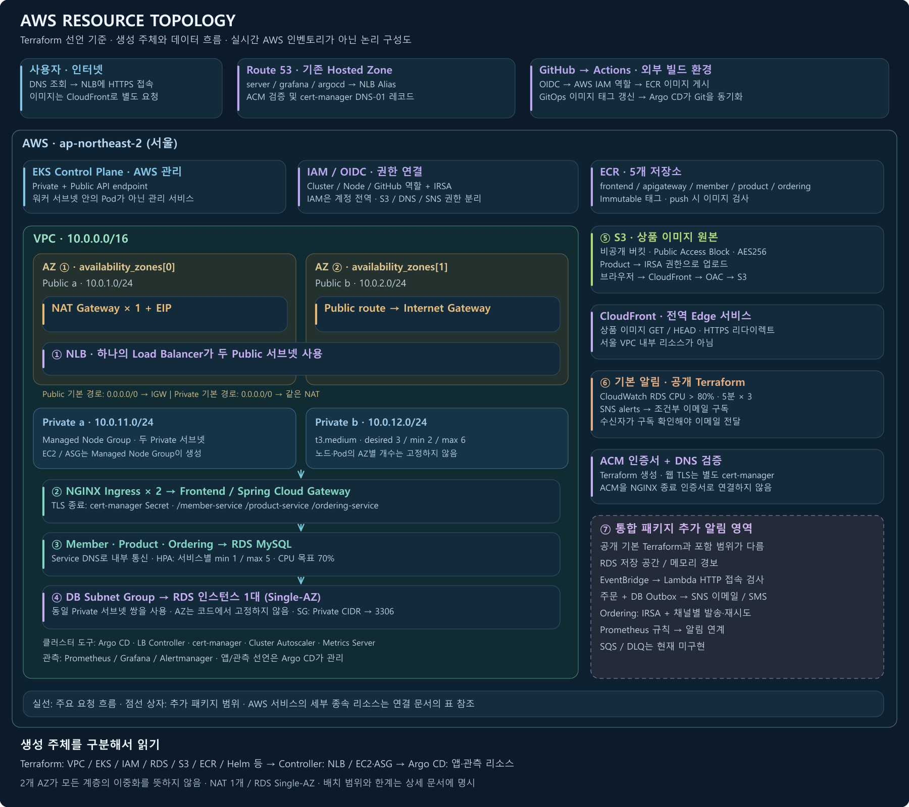
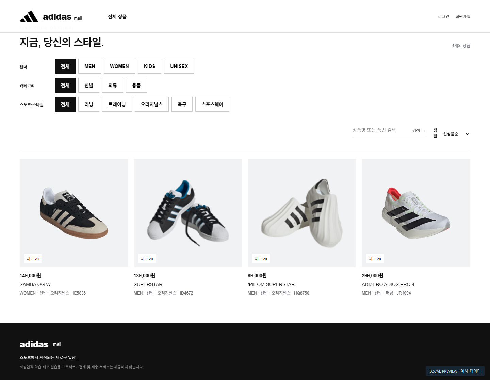
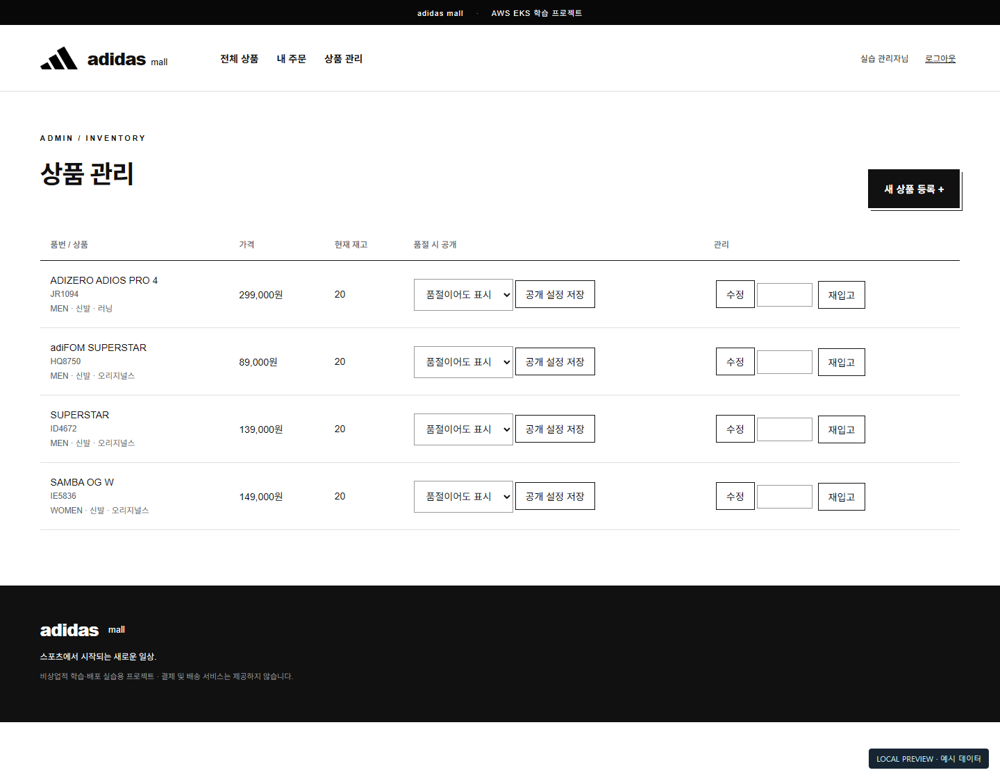

# AWS 기반 MSA 서비스 운영

**인프라 구성부터 배포·관측·장애 복구까지, 쇼핑몰 서비스를 통해 확인한 운영 실습 프로젝트입니다.**

Terraform으로 AWS 환경을 구성하고, GitHub Actions와 Argo CD로 다섯 서비스를 배포했습니다. 서비스가 실행되는 데서 끝내지 않고 주문 데이터·알림·부분 장애와 복구까지 단계별로 확인했습니다.

[전체 구성](docs/architecture.md) · [배포 흐름](docs/delivery.md) · [모니터링·알림](docs/observability.md) · [검증 기록](docs/validation.md) · [확장 검토](docs/extensions.md)

## 전체 구조


- **접속:** 브라우저 → NLB → NGINX Ingress → Frontend / Spring Cloud Gateway → 내부 서비스 → RDS
- **배포:** GitHub → Actions → ECR, GitOps 선언 변경 → Argo CD → EKS
- **주문 알림:** 주문·DB Outbox 저장 → 발송 작업 → SNS → 이메일 / 조건부 SMS

Route 53는 주소 조회를 담당합니다. 외부 진입점은 **NLB**, 앱 내부 API 라우터는 **Spring Cloud Gateway**입니다. 상품 이미지는 별도 CloudFront → 비공개 S3 경로로 전달합니다.

### AWS 생성 리소스 상세 토폴로지

[](docs/assets/aws-resources-detail.png)

[**배치·역할·요청 흐름 상세 설명**](docs/aws-resource-topology.md) · [Terraform 선언 전체 목록](docs/aws-resource-inventory.md) · [확대 이미지](docs/assets/aws-resources-detail.png)

실제 코드 기준의 논리 배치입니다. Terraform 직접 생성, 컨트롤러 생성, 기존 리소스 조회와 추가 알림 패키지 범위를 구분했습니다.


## 진행 과정과 결과

| 단계 | 구현·변경 | 확인한 결과 | 배포 기록 |
| --- | --- | --- | --- |
| **01 · 최초 배포** | AWS 인프라, 다섯 서비스, 상품·이미지, 모니터링 | 쇼핑몰·상품 API와 Argo CD·Grafana 접속 | [Actions](https://github.com/yobi84-sy/msa/actions/runs/39123913768) |
| **02 · 몰 개선** | 검색·분류·정렬, 관리자 기능, 주문 스냅샷·중복 방지, Outbox 알림 | 개선 화면·주문 내역과 새 주문 이메일 수신 | [Actions](https://github.com/yobi84-sy/msa/actions/runs/39135985953) |
| **03 · 장애 재현** | 품절 공개 설정의 API 계약 불일치 | 설정 저장 실패와 정상 재고 보충을 구분 | [Actions](https://github.com/yobi84-sy/msa/actions/runs/39137464044) |
| **04 · 복구** | 같은 API 계약을 복구 | 설정 저장·새로고침 후 값 유지 확인 | [Actions](https://github.com/yobi84-sy/msa/actions/runs/39138395458) |

Actions 링크는 **빌드·워크플로 성공 기록**입니다. 브라우저 동작·이메일 수신은 실습 중 확인한 결과이며, [검증 기록](docs/validation.md)에서 증거의 종류와 미확인 범위를 구분했습니다.

## 결과물 미리보기

| 쇼핑몰 | 관리자 상품 관리 |
| --- | --- |
|  |  |
| 상품 탐색·분류·검색·정렬 | 상품 수정·재고 보충·품절 공개 설정 |

위 화면은 **현재 프런트엔드 소스를 예시 데이터로 로컬 재현한 이미지**입니다. 실시간 운영 상태나 부하 테스트 결과를 뜻하지 않습니다.

## 운영에서 다룬 부분

| 주제 | 적용 내용 |
| --- | --- |
| 배포 추적 | 소스 SHA·요청 ID·run ID/attempt와 이미지 태그를 연결하고 GitOps revision 확인 |
| 주문 일관성 | 요청 키 중복 확인, 상품 행 잠금·조건부 재고 차감, 주문과 Outbox를 같은 트랜잭션에 기록 |
| 알림 전달 | 채널별 발송·재시도·실패 상태, 이메일 구독 확인, 검증된 SMS 번호와 일일 시도 제한 |
| 관측 | Prometheus·Grafana, Pod·노드·Argo 상태 규칙, CloudWatch RDS·접속 검사 |
| 복구 확인 | 기본 HTTP 성공과 특정 기능의 정상 동작을 구분하고 동일 사용자 동작으로 재검증 |

## 사용 기술과 저장소

| 영역 | 기술 |
| --- | --- |
| 인프라·네트워크 | Terraform · VPC · EKS · IAM/OIDC/IRSA · NLB · Route 53 · cert-manager |
| 빌드·배포 | Docker · ECR · GitHub Actions · Argo CD · Helm · Kustomize |
| 애플리케이션·데이터 | Java 17 · Spring Boot / Cloud Gateway · NGINX · RDS MySQL · S3 / CloudFront |
| 운영·알림 | Prometheus · Grafana · Alertmanager · CloudWatch · SNS |

```text
msa/                    # 앱 소스·Dockerfile·Kubernetes 배포 선언
argocd/                 # App-of-Apps 및 앱/모니터링 소유권
terraform/              # AWS 인프라·클러스터 도구·웹 진입 경로
.github/workflows/      # 최초 빌드와 검토한 앱 패치
scripts/                # 패치 후 배포 선언 준비
first-install-baseline/ # 1차 앱 기준 소스
docs/                   # 구성·과정·검증·문제 해결·확장 검토
```

## 상세 문서

| 문서 | 읽을 내용 |
| --- | --- |
| [전체 구성](docs/architecture.md) | 네트워크·서비스 역할·데이터 경로와 구성 선택 |
| [AWS 리소스 상세](docs/aws-resource-topology.md) | 서브넷·라우팅·생성 주체·서비스 역할과 요청 흐름 |
| [배포 과정](docs/delivery.md) | 최초 배포 → 개선 → 장애 → 복구, 이미지·GitOps 추적 |
| [모니터링과 주문 알림](docs/observability.md) | 경보 조건, Outbox·SNS의 상태와 제약 |
| [검증 기록](docs/validation.md) | 실제 확인, 로컬 검사, 구현만 된 부분, 남은 검증 |
| [문제 해결 기록](docs/troubleshooting.md) | 증상 → 원인 → 변경 → 확인 |
| [실행 안내](docs/runbook.md) | 공개 소스와 통합 실행 패키지 범위, 준비·확인·삭제 |
| [확장 검토 사항](docs/extensions.md) | SQS 등을 아직 쓰지 않은 이유·필요한 상황·추가 방법 |
| [운영 편의 도구·애니메이션](docs/tools.md) | GUI와 독립 실행 HTML 설명 |

### 구동 과정을 움직임으로 보기

[**단일 HTML 애니메이션 파일**](docs/demo/msa-flow.html)을 내려받아 브라우저에서 열면 설치 → 배포 → 접속 → 주문 알림 → 장애·복구를 살펴볼 수 있습니다. 5개 챕터·24개 장면이며, 일시정지·단계 이동·상세 설정 보기를 지원합니다. **GitHub 파일 미리보기에서는 실행되지 않으며 다운로드 후 열어야 합니다.**

## 현재 범위

RDS는 Single-AZ, NAT Gateway는 1개입니다. 서비스 일부가 한 파드에서 시작하며 **모든 장애에서의 무중단을 보장하는 구성은 아닙니다.** SQS·Redis·Kafka와 S3 원격 state는 현재 적용 완료 항목에 포함하지 않습니다.

도메인은 실습 환경을 설치했을 때만 접속할 수 있습니다. 공개 저장소와 로컬 통합 실행 패키지의 포함 범위는 [실행 안내](docs/runbook.md)에서 확인할 수 있습니다. 결제·배송을 제공하는 상용 쇼핑몰은 아닙니다.
