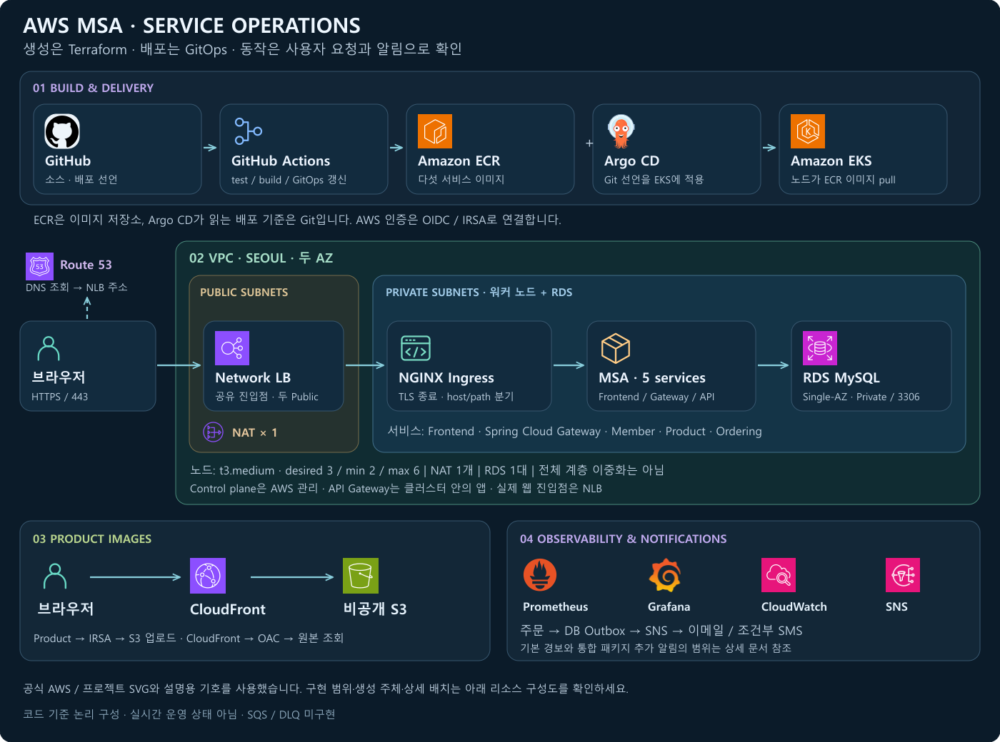

# 전체 구성

[프로젝트 홈](../README.md) · [배포 과정](delivery.md) · [확장 검토](extensions.md)

[**AWS 생성 리소스 상세 토폴로지**](aws-resource-topology.md)에서 두 AZ의 배치·라우팅·생성 주체를 확인할 수 있습니다. [Terraform 선언 전체 목록](aws-resource-inventory.md)도 함께 제공합니다.

## 네트워크와 실행 영역

| 항목 | 현재 구성 | 선택과 영향 |
| --- | --- | --- |
| 리전·VPC | 서울, `10.0.0.0/16` | 한 리전의 실습 환경 |
| Public 서브넷 | `10.0.1.0/24`, `10.0.2.0/24` | 서로 다른 두 AZ에 NLB 경로 구성 |
| Private 서브넷 | `10.0.11.0/24`, `10.0.12.0/24` | 워커 노드와 RDS의 서브넷 집합. 별도 전용 DB 서브넷은 없음 |
| 외부 통신 | Public a의 NAT 1개, Private 기본 경로가 NAT 참조 | 비용·구성 수를 줄인 대신 NAT의 AZ 장애 의존성 존재 |
| EKS 워커 | `t3.medium`, desired 3 / min 2 / max 6 | Private 서브넷 사용. control plane은 AWS 관리 |
| EKS API | public·private endpoint 모두 활성화 | 운영 접근 제한은 추가 검토 사항 |
| DB | MySQL 8.4, `db.t4g.micro`, 20 GiB gp3, Single-AZ | 인스턴스·AZ 장애 시 자동 이중화 범위 제한 |

근거: [network.tf](../terraform/network.tf), [nat.tf](../terraform/nat.tf), [eks.tf](../terraform/eks.tf), [eks-nodegroup.tf](../terraform/eks-nodegroup.tf), [rds.tf](../terraform/rds.tf).

## 사용자 접속과 API 경로

1. 브라우저가 Route 53를 통해 `server.sy84.store`의 NLB 주소를 조회합니다.
2. 브라우저가 NLB에 HTTPS 연결을 엽니다. **DNS는 이 HTTP 트래픽을 중계하지 않습니다.**
3. NLB가 NGINX Ingress Controller로 전달합니다. 컨트롤러는 두 파드로 구성합니다.
4. NGINX가 TLS를 종료하고 host/path로 라우팅합니다.
5. `/`는 Frontend, `/member-service`, `/product-service`, `/ordering-service`는 앱 API Gateway로 보냅니다.
6. Spring Cloud Gateway가 `StripPrefix=1`로 접두사를 제거해 내부 Service로 전달합니다.

**Spring Cloud Gateway는 EKS 안의 애플리케이션입니다. AWS 관리형 API Gateway를 생성한 것은 아닙니다.** AWS Load Balancer Controller를 사용하지만 이 웹 진입점의 실제 유형은 **NLB**입니다.

근거: [NGINX/NLB 설정](../terraform/eks-nginx-helm.tf), [Ingress](../terraform/eks-msa-ingress.tf), [Gateway 라우트](../msa/apigateway/src/main/resources/application-prod.yml).

## 도메인과 인증서

`server`, `grafana`, `argocd.sy84.store`는 공유 NLB의 A Alias를 사용합니다. 실제 웹 TLS는 cert-manager의 Let's Encrypt DNS-01 인증서 Secret을 NGINX가 사용합니다. ACM 인증서 리소스도 있지만 이를 현재 NGINX 경로의 TLS 종료 인증서로 설명하지 않습니다.

근거: [Route 53](../terraform/route53-nlb.tf), [cert-manager TLS](../terraform/eks-cert-manager-tls.tf), [ACM 리소스](../terraform/acm.tf).

## 데이터와 이미지

회원·상품·주문은 같은 RDS의 테이블을 사용합니다. 서비스별 독립 DB를 구성한 상태는 아닙니다. RDS는 외부 공개가 꺼져 있고 Private 서브넷 CIDR에서 3306 접근을 허용합니다. 주문 서비스도 상품 테이블을 직접 조회·잠그므로 데이터 모델의 결합이 남아 있습니다.

이미지는 `Product → S3`로 업로드하고 `브라우저 → CloudFront → S3`로 읽습니다. S3 Public Access Block과 CloudFront OAC를 사용합니다. **쇼핑몰 HTML/API 전체를 CloudFront에 연결한 구성은 아닙니다.**

근거: [DB 보안 그룹](../terraform/security.tf), [S3](../terraform/s3.tf), [CloudFront/OAC](../terraform/s3-cloudfront.tf), [주문 처리](../msa/ordering/src/main/java/com/example/ordersystem/ordering/service/OrderingService.java).

## 권한과 소유권

- GitHub Actions: GitHub OIDC로 IAM 역할을 받아 ECR에 게시합니다.
- 앱 AWS 접근: EKS OIDC/IRSA로 Product의 S3 권한, Ordering의 SNS 권한 등을 분리합니다.
- Terraform: AWS 기반과 Helm 도구를 관리합니다.
- Argo CD: `msa-root` 아래 앱과 모니터링의 Kubernetes 선언을 관리합니다.
- HPA: 앱 replica 수를 변경합니다. Argo가 이를 다시 덮어쓰지 않도록 replicas 차이를 무시합니다.

[Argo 앱 소유권](../argocd/apps/yobi-v1-msa.yml) · [GitHub 역할](../terraform/github-actions-iam.tf) · [상품 IRSA](../terraform/eks-product-s3-iam.tf)

## 구성도를 읽을 때

운영 도구와 AWS 관리 서비스의 위치는 논리적 배치입니다. AWS control plane을 워커 노드와 같은 서브넷 안의 앱으로 해석하지 않습니다. 현재 한계와 확장 조건은 [확장 검토 사항](extensions.md)에 따로 정리했습니다.
