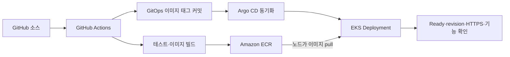

# 배포 과정과 변경 추적

[프로젝트 홈](../README.md) · [검증 기록](validation.md) · [실행 안내](runbook.md)

## 역할을 나눈 배포 흐름



Actions는 이미지와 GitOps 커밋을 만듭니다. Argo CD가 배포를 반영하므로 CI에서 같은 앱을 `kubectl apply`로 중복 관리하지 않습니다. Helm은 클러스터 도구 설치, Kustomize는 앱/모니터링 선언 묶음에 사용합니다.

## 1차 · 실행 기반과 앱

설치 흐름은 계정·계획 확인 → Terraform → Secret → 1차 기준 소스 → 전체 빌드 → Argo root 등록 → revision/rollout/HTTPS → 상품 확인입니다. 로컬 최신 통합 실행 패키지는 이후 운영 알림 구성까지 이어서 실행합니다.

통합 패키지와 공개 저장소의 설치 스크립트가 완전히 동일한 배포본은 아닙니다. 알림 생성기와 최신 설치/삭제 보완은 통합 패키지에 있는 항목이므로 [실행 범위](runbook.md#공개-저장소와-통합-실행-패키지)를 먼저 확인합니다.

1차 기준 소스는 별도 관리 clone에 복원합니다. 이미 2차 이후의 코드가 원격에 있어도 1차 앱 실습을 준비하기 위한 구조이며, 기존 운영 DB를 무조건 초기화한다는 뜻은 아닙니다.

## 2차 · 몰 개선과 주문 처리

| 변경 | 구현 의미 |
| --- | --- |
| 쇼핑몰 화면·탐색 | 젠더·카테고리·스타일, 검색, 가격 정렬 |
| 인증·관리자 | 회원/관리자 권한 확인, 상품 수정·재고 보충·품절 공개 설정 |
| 주문 요청 키 | 같은 요청 키의 재전송이 새 주문·재고 차감으로 이어지는 것을 방지 |
| 재고 동시성 | 상품 행 잠금과 조건부 차감으로 마지막 재고의 중복 판매 방어 |
| 주문 기록 | 새 주문의 상품명·단가 스냅샷 기록. 기존 주문은 보존 |
| Outbox | 주문·재고·알림 대기 기록을 같은 트랜잭션에 저장 |

DB 변경 패치는 통합 실행 패키지에서 스냅샷을 확인한 뒤 게시합니다. 기존 주문의 이름·가격 필드가 없었다면 새 코드가 과거 값을 임의로 만들어 넣지 않습니다.

## 3차 → 4차 · 같은 기능으로 장애와 복구 확인

3차 `soldout-visibility-incident`는 **관리자 품절 공개 설정 저장의 API 계약 불일치**를 재현합니다. 재고 보충과 일반 접속은 정상일 수 있습니다. 따라서 Pod Ready와 HTTP 200만으로 해당 기능이 정상이라고 판단하지 않습니다.

4차 `soldout-visibility-recovery`는 계약을 복구합니다. 같은 화면에서 저장 → 새로고침 → 값 유지를 확인합니다. 현재 기본 브랜치의 앱 소스는 복구 단계입니다.

## 요청과 이미지의 연결

수동 workflow는 `service`, `request_id`, `expected_sha`를 받습니다. 배포 실행기는 소스 SHA·요청 제목·브랜치·실행 ID를 연결해 다른 빌드 결과를 잘못 고르지 않도록 검사합니다.

```text
source SHA → workflow run ID / attempt
image tag = sourceSHA-runID-attempt
GitOps commit → Argo sync revision → 실제 Deployment 이미지·Ready
```

[최초 빌드 workflow](../.github/workflows/deploy-yobi-gitops.yml) · [패치 workflow](../.github/workflows/deploy-yobi-patch.yml)

네 Java 서비스의 Dockerfile은 `./gradlew test bootJar`를 수행합니다. 프런트엔드는 NGINX 정적 파일 이미지이며 같은 Java 테스트를 실행하는 것은 아닙니다. 현재 패치 workflow는 `workflow_dispatch` 진입점입니다. 설명 주석에 push 선택 로직이 남아 있어도 실제 YAML의 `on` 조건을 기준으로 읽습니다.

## 이번 기록에서 확인한 성공

| 구간 | Actions | 소스 커밋 |
| --- | --- | --- |
| 1차 전체 빌드 | [39123913768](https://github.com/yobi84-sy/msa/actions/runs/39123913768) | `4287f4f` |
| 2차 개선 | [39135985953](https://github.com/yobi84-sy/msa/actions/runs/39135985953) | `219813f` |
| 3차 장애 재현 | [39137464044](https://github.com/yobi84-sy/msa/actions/runs/39137464044) | `12923fe` |
| 4차 복구 | [39138395458](https://github.com/yobi84-sy/msa/actions/runs/39138395458) | `6508b0d` |

2026-10-19 문서 정리 시 GitHub API로 네 실행의 completed/success를 조회했습니다. 마지막 복구의 GitOps 커밋은 `15d748f`입니다. Actions 성공을 이메일 수신·전체 기능·가용성 테스트의 증거로 대신하지 않습니다.
