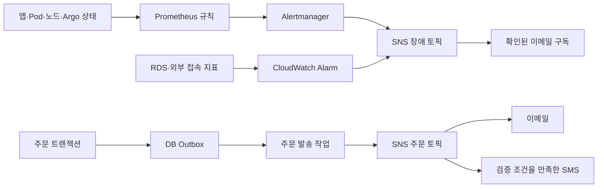

# 모니터링과 주문 알림

[프로젝트 홈](../README.md) · [전체 구성](architecture.md) · [검증 기록](validation.md)

## 두 가지 알림 흐름



Grafana는 Prometheus를 조회하는 대시보드입니다. 모든 알림을 Grafana가 직접 발송하는 방식으로 구성하지 않았습니다. 운영 경보와 주문 알림은 대상·발생 조건이 다릅니다.

## 구성한 경보 조건

| 대상 | 조건 | 판정 경로 |
| --- | --- | --- |
| 공개 쇼핑몰·상품 API | CloudWatch 1분 구간 연속 실패 / Prometheus `for: 3m` | 외부 probe/blackbox와 CloudWatch·Prometheus |
| 앱 가용성 | 정상 replica 0개, 2분 지속 | kube-state-metrics → Prometheus |
| 반복 재시작 | 10분 구간 3회 이상, 규칙 `for: 1m` | Prometheus |
| 노드 | NotReady 3분 / 메모리 사용률 90% 초과 5분 | Prometheus |
| Argo CD | OutOfSync 또는 비정상 상태 5분 | Prometheus |
| HPA·노드 최대치 | 설정 최대치 도달 상태 5분 | Prometheus |
| RDS CPU | 80% 초과, 5분 구간 3회 | CloudWatch |
| RDS 가용 메모리 | 128 MiB 미만, 1분 구간 5회 | CloudWatch |
| RDS 여유 공간 | 할당 저장 공간의 20% 미만, 1분 구간 5회 | CloudWatch |
| 수집기·주문 발송 | 수집기 중단 / 발송 실패 counter 증가 | Prometheus |

공개 저장소에는 [생성된 알림 리소스](../msa/k8s/k8s-monitoring/alerts-resources.yml), [Prometheus 설정](../msa/k8s/k8s-monitoring/prometheus-config.yml), [RDS CPU Terraform](../terraform/yobi-alerts.tf)이 있습니다. 추가 CloudWatch 알람과 생성기 원본은 로컬 통합 실행 패키지의 `operations/notifications/`에 있습니다. 표는 실제 메일 수신을 전부 재검증했다는 뜻이 아닙니다.

## 이메일 구독과 SMS

설치·알림 구성은 SNS 구독을 생성합니다. **수신자는 장애용·주문용 확인 메일에서 각각 Confirm subscription을 눌러야 합니다.** `PendingConfirmation`이면 실제 이메일 알림을 받을 준비가 끝난 상태가 아닙니다.

SMS는 검증된 SNS 샌드박스 번호가 있을 때 사용합니다. 통합 설정은 검증된 번호가 없으면 이메일만 진행하고, 여러 번호가 있으면 대상을 임의로 고르지 않습니다. 앱은 UTC 하루 SMS **발송 시도** 10회로 제한합니다. 이 수치는 AWS 계정의 전체 비용 한도가 아닙니다.

## 주문 Outbox의 상태

근거: [주문 처리](../msa/ordering/src/main/java/com/example/ordersystem/ordering/service/OrderingService.java), [Outbox 적재](../msa/ordering/src/main/java/com/example/ordersystem/ordering/service/OrderNotificationOutbox.java), [발송 작업](../msa/ordering/src/main/java/com/example/ordersystem/ordering/service/OrderNotificationDispatcher.java).

```text
재고 차감 + 주문 + 채널별 Outbox INSERT (한 DB 트랜잭션)
                    ↓ commit
PENDING → SENDING → SNS 수락 → SENT
              ↘ 실패 → PENDING 재시도 → 최대 5회 후 FAILED
```

- 발송 작업은 기본 5초 간격이며 SENDING 임대는 60초입니다.
- 발송 예외 후 대기 시간은 60→120→240→480초이며, 다섯 번째 실패 후 FAILED가 됩니다.
- SMS 대상이 비어 있으면 SKIPPED, 일일 시도 한도에 도달하면 다음 UTC 날짜로 연기합니다.
- **SENT는 SNS API가 요청을 수락했다는 의미입니다. 최종 이메일·단말 수신 보장은 아닙니다.**
- 게시 후 DB 상태 기록 전에 프로세스가 중단되는 경우 등에는 중복 전달 가능성이 있습니다.

## 확인한 결과와 다음 검증

실습에서 새 주문 이메일과 RDS 메모리 ALARM/OK 전환 메일을 확인했습니다. SMS 설정 코드·조건은 있지만 최종 문자 수신을 완료한 기록은 이번 문서의 확인 결과에 포함하지 않습니다.

재현할 때는 알람 이름·발생/복구 시간·수신 시간을 함께 기록합니다. CPU 부하나 최대 replica 도달 시험은 별도 승인된 실습으로 진행해야 하며, 현재 문서는 부하를 발생시키지 않습니다. 메모리 경보가 반복된다고 원인 확인 없이 임계값만 바꾸지는 않습니다.
