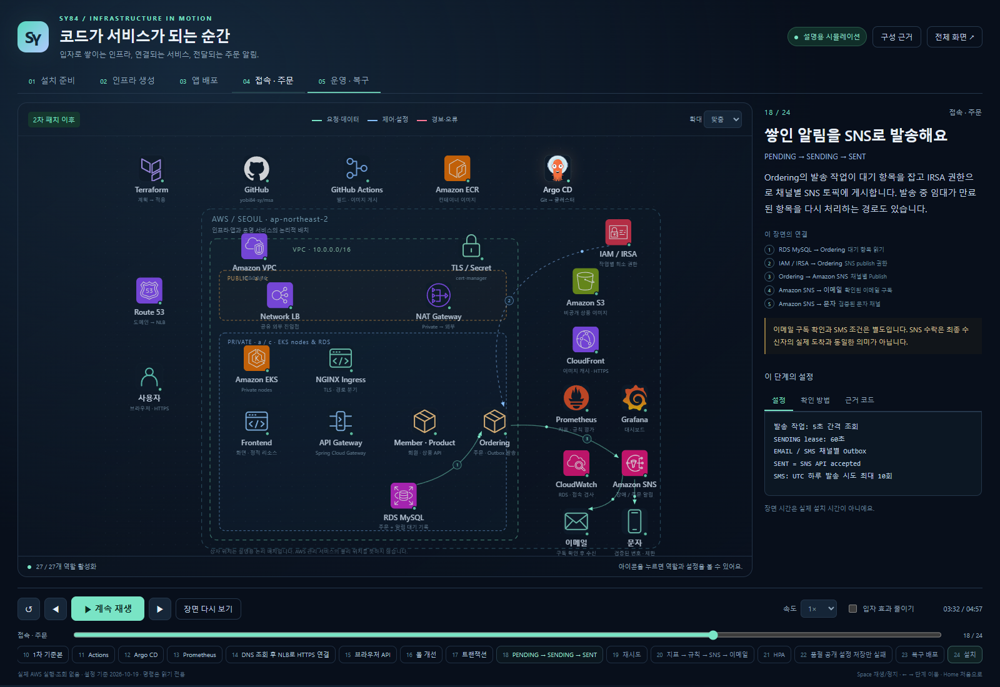

# 운영 편의 도구와 구동 애니메이션

[프로젝트 홈](../README.md) · [실행 안내](runbook.md)

## 운영 편의 도구

GUI는 반복되는 설치·계획 확인·패치·알림 설정·삭제를 편하게 수행하기 위한 보조 도구입니다. 프로젝트의 핵심 운영 구조는 Terraform·GitHub Actions·Argo CD·Kubernetes 선언에 있습니다.

GUI는 별도 통합 실행 패키지에 포함됩니다. 현재 공개 저장소가 GUI 배포 패키지를 제공하는 것은 아닙니다. 통합본의 **수동 입력 가이드**에서는 PowerShell 진입점과 Terraform·kubectl의 역할을 단계별로 확인하고 명령을 복사할 수 있습니다. 명령은 자동 실행하지 않습니다.

## 설치·구동 과정을 설명하는 애니메이션

[**단일 HTML 파일 보기/다운로드**](demo/msa-flow.html)

1. GitHub 파일 화면에서 **Download raw file**로 HTML을 내려받습니다.
2. 내려받은 HTML을 Edge/Chrome으로 엽니다.
3. **스타트**를 누르거나 챕터/장면을 선택합니다.

HTML 파일 하나에 아이콘·스타일·동작·설명이 모두 들어 있습니다. 저장소나 통합 패키지의 다른 파일, 인터넷, Node/Docker/웹 서버가 없어도 실행됩니다. GitHub 소스 미리보기에서 HTML이 바로 실행되는 것은 아닙니다.

| 기능 | 내용 |
| --- | --- |
| 장면 | 5개 챕터·24개 장면·27개 서비스/역할 |
| 연출 | 입자가 모여 아이콘 형성 → 방향선과 패킷으로 연결 설명 |
| 조작 | 재생/정지, 이전/다음, 현재 장면 다시 보기, 처음으로, 속도·확대·전체 화면 |
| 학습 | 아이콘 역할·설정·확인 방법·코드 근거 보기 |
| 접근성 | 입자 줄이기, 키보드 이동, 운영체제 reduced-motion 선호 반영 |

**AWS를 조회하거나 리소스·주문·알림을 생성하는 화면이 아닙니다.** 시간·장애·활성화 상태는 설명용입니다. 현재 통합 실습 구성 기준이며 공개 저장소의 일부 예전 보조 스크립트와 버전 차이는 [실행 안내](runbook.md)에 표시했습니다.

AWS·GitHub·Argo CD·Prometheus·Grafana 아이콘은 기존 제공 자산을 사용했습니다. SNS는 [AWS Icons for PlantUML](https://github.com/awslabs/aws-icons-for-plantuml) 아이콘을 사용했고, Terraform·Actions·앱·이메일·문자는 역할을 나타내는 도식 기호입니다. 자세한 출처는 HTML 안의 `iconSources`와 `snsIconSource`에 포함됩니다.
